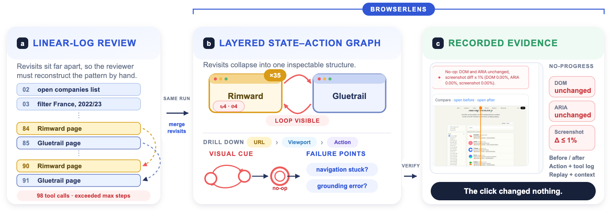
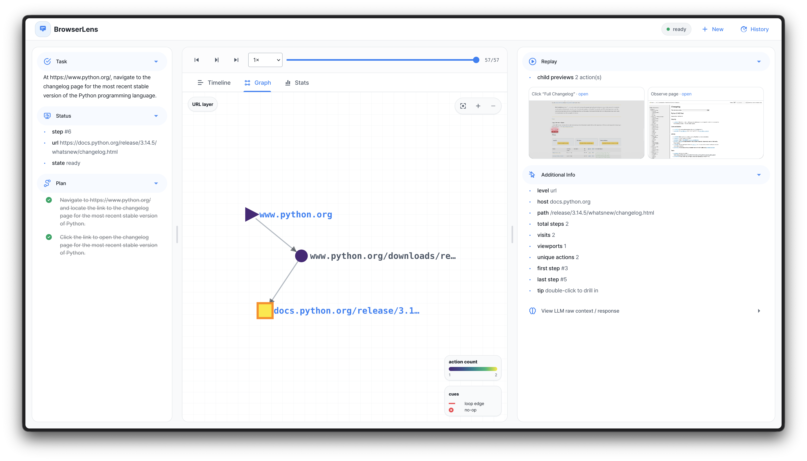
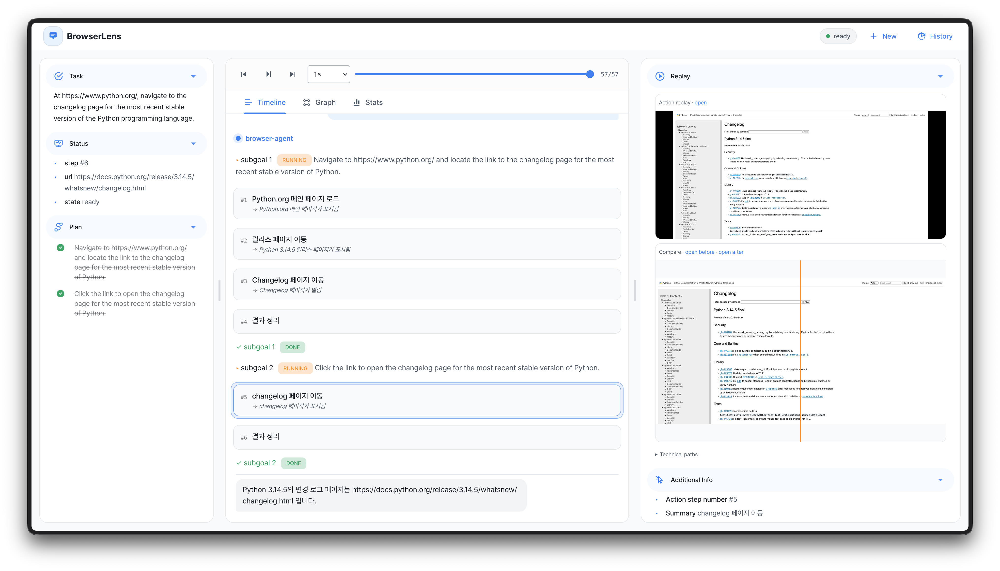
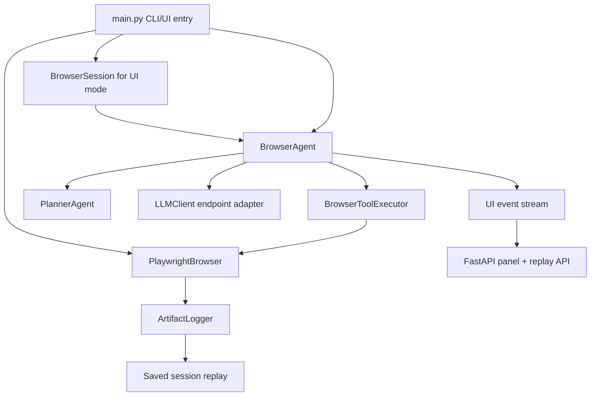

# BrowserLens

**Interactive diagnosis of web-agent trajectories with a layered state-action graph.**

Junyeong Song, Mingyu Kim, Seongkook Heo · Ulsan National Institute of Science and Technology (UNIST)<br>
UIST 2026 Poster (UIST Adjunct '26, Detroit, MI, USA)

[Paper (PDF)](docs/uist26/browserlens-uist26-paper.pdf) ·
[Poster (PDF)](docs/uist26/browserlens-uist26-poster.pdf) ·
[Video](docs/uist26/browserlens-uist26-video.mp4) ([captions](docs/uist26/browserlens-uist26-video.srt)) ·
[Blog post](https://junyeong-nero.github.io/research-blog/post.html?slug=browserlens-uist-2026) ·
[Citation](#citation)

<p align="center">
  
</p>

A completed web-agent run leaves only a trajectory: a long linear log in which
cross-step structure such as revisits, loops, dead ends, and stalls is scattered
across distant entries. BrowserLens is a read-only diagnosis workspace that
reorganizes a single logged trajectory around browser-state identity rather than
time.

- **Layered state-action graph.** Normalized URLs, viewports, and state-anchored
  actions form a three-layer graph (URL → Viewport → State-Anchored Action).
  Revisits collapse into single nodes, so repetition becomes visible structure.
- **Visual cues, not verdicts.** Four cues mark suspicious structure: repeated-node
  highlights, loop-edge highlights, no-op node highlights, and hidden-cue badges
  on collapsed parents. A cue is an attention signal, not a failure label.
- **Cue → tentative failure point → evidence.** A cue suggests candidate failures
  (repeated state, repeated action, navigation loop, dead-end, navigation stuck,
  grounding error). The reviewer confirms or rejects each one against the
  recorded evidence: screenshots, DOM/ARIA snapshots, action and tool logs, LLM
  context, and replay.

<p align="center">
  
</p>

This repository contains the browser-agent runtime that records
logging-enabled trajectories, the BrowserLens web UI for live and saved
sessions, and the UIST '26 paper, poster, and video under
[`docs/uist26/`](docs/uist26/).

## Scope

- Read-only diagnosis of logging-enabled runs, live or saved. Steering and
  repair are out of scope.
- State identity is heuristic. A volatile URL can split one screen into several
  nodes, and distinct screens (for example, a modal over the same page) can merge
  into one. The repeated-node and loop cues inherit this limit.
- The bundled agent exists to produce trajectories to diagnose. It makes no
  claim about web-agent task performance.

## Requirements

- Python `>=3.12,<3.13`
- [`uv`](https://docs.astral.sh/uv/)
- Chromium installed through Playwright
- An API key for the configured model endpoint
- Optional: `ffmpeg` for GIF and MP4 artifacts

## Setup

```bash
git clone https://github.com/junyeong-nero/browser-lens.git
cd browser-lens
uv sync --dev
uv run playwright install chromium
```

If Playwright needs system packages on your machine:

```bash
uv run playwright install-deps chromium
```

The checked-in `config.yaml` sends the actor, planner, and summary models to the
OpenAI API, so one key is enough for the default setup. Keys are read from the
environment; `.env` files are not loaded.

```bash
export OPENAI_API_KEY="..."
```

## Quick start

Start the BrowserLens UI with logging enabled:

```bash
uv run main.py --log --highlight_mouse
```

Submit a task from the panel, watch the graph and timeline update, and stop
the task with the same Run/Stop button. Runs recorded with `--log` are saved under
`logs/history/<timestamp>/` and can be reopened from **History** without
rerunning the task.

<p align="center">
  
</p>

Run a one-off task from the command line instead:

```bash
uv run main.py "Open Example Domain and summarize the page" --log
uv run main.py "Summarize this page" --initial_url "https://example.com" --log
```

### UI views

Omitting `query` starts a local FastAPI/uvicorn panel. `--ui-condition` selects
the view:

| Value | View |
| --- | --- |
| `c3` (default) | Full BrowserLens: layered graph, cues, timeline, and replay |
| `c2` | BrowserLens without the graph view |
| `c1` | Simple linear log view |

`c1` and `c2` are baseline views kept for side-by-side comparison. The runner
scripts `scripts/c1_run_linear.sh`, `scripts/c2_browser_lens_no_graph.sh`, and
`scripts/c3_browser_lens.sh` start each view with the settings used for trace
collection: planner, logging, text grounding, stealth patches, Korean
locale and timezone, and a desktop Chrome user agent.

## CLI reference

`query` is positional. Omit it to start the UI.

| Argument | Description | Default |
| --- | --- | --- |
| `query` | Browser-agent instruction. Omit to start the UI. | UI mode |
| `--ui-condition` | UI view: `c1`, `c2`, or `c3`. | `c3` |
| `--env` | Browser backend. Currently only `playwright`. | `playwright` |
| `--initial_url` | Initial page loaded in the browser. | `https://www.duckduckgo.com` |
| `--search_engine_url` | URL used by the `search` tool. | `https://www.duckduckgo.com` |
| `--highlight_mouse` | Draw clicked-element and pointer highlights in screenshots. | `False` |
| `--headless` | Launch Playwright headless (`True`/`False`). | `False` |
| `--screen-size` | Browser size as `WIDTHxHEIGHT`, or `auto`. | `auto`, fallback `1600x900` |
| `--log` | Save per-step screenshots, DOM, ARIA, events, GIFs, and action JSONL. | `False` |
| `--video` | Save Playwright video and an optional MP4 stream. | `False` |
| `--model` | Override the actor model from `config.yaml`. | `models.actor.model` |
| `--grounding` | `text`, `vision`, or `mixed`. | `text` |
| `--stealth` | Inject anti-automation browser patches. | `False` |
| `--channel` | Playwright browser channel such as `chrome` or `msedge`. | Playwright Chromium |
| `--locale` | Browser locale, for example `ko-KR`. | unset |
| `--timezone` | IANA timezone id, for example `Asia/Seoul`. | unset |
| `--user-agent` | Override the browser User-Agent. | unset |
| `--proxy` | Proxy URL: `scheme://[user:pass@]host:port`. | unset |
| `--storage-state` | Playwright storage state JSON, loaded on start and saved on exit. | unset |

Grounding modes:

- `text`: ARIA snapshot with stable integer refs. Works with standard
  function-calling models.
- `vision`: screenshot and coordinate actions.
- `mixed`: ARIA refs plus screenshot input.

`vision` and `mixed` need a model that accepts images; set
`supports_image_inputs: true` for it in `config.yaml`.

## Configuration

`config.yaml` defines three model endpoints (`actor`, `planner`, `summary`) and
the execution budget. Each endpoint is OpenAI-compatible:

- `endpoint_url`: API base URL. The key variable is inferred from it:
  `OPENAI_API_KEY` for `api.openai.com`, `OPENROUTER_API_KEY` for OpenRouter,
  `NVIDIA_API_KEY` for NVIDIA, and `LLM_API_KEY` otherwise. `api_key_env`
  overrides the inference.
- `api`: `responses` (OpenAI Responses API, the default) or `chat` for endpoints
  that only support Chat Completions.
- `model`, `temperature`, `reasoning.effort`, `token_limit_field`, `headers`,
  `extra_body`, `supports_image_inputs`: per-endpoint model options.

`constraints` sets the step budget: `max_steps_per_subgoal`, `max_total_steps`,
and `max_subgoals` (the maximum number of plan iterations).

The planner writes a high-level natural-language plan. The actor executes it one
step at a time, and the planner regenerates the remaining plan only after a
step fails.

## Environment variables

| Variable | Used for |
| --- | --- |
| `OPENAI_API_KEY`, `OPENROUTER_API_KEY`, `NVIDIA_API_KEY`, `LLM_API_KEY` | Bearer tokens inferred from the configured endpoints. |
| `LLM_TIMEOUT_SECONDS` | Timeout for actor and planner requests. Defaults to 120 seconds. |
| `ACTION_SUMMARY_ENDPOINT_URL` | Override the summary endpoint URL. |
| `ACTION_SUMMARY_API_KEY_ENV` | Override which variable supplies the summary key. |
| `ACTION_SUMMARY_MODEL` | Override the action summary model. |
| `ACTION_SUMMARY_TIMEOUT_SECONDS` | Timeout for action summaries. Defaults to 10 seconds. |
| `COMPUTER_USE_FFMPEG_COMMAND` | Explicit ffmpeg binary for GIF and video encoding. |
| `USE_PATCHRIGHT=1` | Try Patchright before falling back to Playwright. |

## Diagnosis artifacts

With `--log`, a run is saved as:

```text
logs/history/<timestamp>/
├── session.json          # task, models, grounding, planner, constraints
├── events.jsonl          # replayable UI, model, and tool event stream
├── actions.jsonl         # compact action trajectory
└── history/
    ├── step-0001.png     # viewport screenshot
    ├── step-0001.html    # DOM snapshot
    ├── step-0001.a11y.yaml
    ├── step-0001.gif     # before/after GIF when ffmpeg is available
    └── ...               # per-step metadata and LLM context
```

With `--video`, Playwright `.webm` recordings and an optional `session_60fps.mp4`
are saved under `logs/history/<timestamp>/video/`.

The graph and its cues are derived indexes over these logged states,
transitions, and outcomes. The evidence itself stays in the saved artifacts and
is served to the UI through the replay API.

## Batch trace collection

`scripts/run_batch.sh` runs the task set in `experiments/tasks_en.json` and
`experiments/tasks_ko.json` (one `query` per task, English and Korean versions)
through `main.py`, with the same defaults as `scripts/c3_browser_lens.sh`.

```bash
# Run every task in both languages, logging artifacts
scripts/run_batch.sh

# Dry-run the first five English "main" tasks
scripts/run_batch.sh --use main --lang en --limit 5 --dry-run
```

Other options include `--tasks-file PATH`, `--from N`, `--no-log`, `--video`,
`--headless True|False`, `--stop-on-failure`, and `-- <extra main.py args>`.
`scripts/validate_trajectories.py` sorts collected runs by whether they reached
a natural end (task complete or task failed).

## Architecture



- `main.py`: CLI parser, browser setup, CLI/UI mode selection.
- `src/agents/actor/`: the agent loop, Plan-and-Act step execution, model-turn
  parsing, context compaction, and safety checks.
- `src/agents/planner/`: the planner and remaining-plan regeneration.
- `src/agents/summarizer/`: action summaries, ambiguity detection, and review
  metadata.
- `src/llm/`: endpoint setup and retries (`client.py`) and the OpenAI-compatible
  Responses and Chat Completions adapters (`provider/`).
- `src/browser/`: Playwright control, ARIA snapshots, browser state and state
  graph capture, recording, and artifact logging.
- `src/tool_executor.py`, `src/tools/`: browser tool declarations, handlers, and
  execution.
- `src/ui/`: the shared panel server, the task/event bridge, the replay API,
  and one folder per UI view (`c1_simple_ui/`, `c2_browser_lens_no_graph/`,
  `c3_browser_lens/`).

## Development

```bash
uv run pytest
uv run main.py --help
```

## Security and privacy

- Do not hardcode API keys; use environment variables.
- `--log` and `--video` can capture sensitive page content: URLs, DOM,
  accessibility trees, screenshots, model prompts, tool results, and video.
  Review `logs/history/<timestamp>/` before sharing it.
- The Playwright backend keeps the browser sandbox enabled.
- File uploads are limited to paths under the working directory or the system
  temp directory.

## Citation

```bibtex
@inproceedings{song2026browserlens,
  author    = {Song, Junyeong and Kim, Mingyu and Heo, Seongkook},
  title     = {BrowserLens: Interactive Diagnosis of Web-Agent Trajectories with a Layered State-Action Graph},
  booktitle = {The 39th Annual ACM Symposium on User Interface Software and Technology (UIST Adjunct '26)},
  series    = {UIST Adjunct '26},
  year      = {2026},
  month     = nov,
  location  = {Detroit, MI, USA},
  publisher = {Association for Computing Machinery},
  address   = {New York, NY, USA},
  numpages  = {3},
  isbn      = {979-8-4007-2855-6},
  doi       = {10.1145/3830397.3841876}
}
```

## License

The source code is licensed under the [MIT License](LICENSE). The paper,
poster, video, and images in [`docs/`](docs/) are licensed under the
[Creative Commons Attribution 4.0 International License (CC BY 4.0)](docs/LICENSE).

## Acknowledgments

This work was supported by the InnoCORE program of the Ministry of Science and
ICT (UNIST 2.260039.01).
